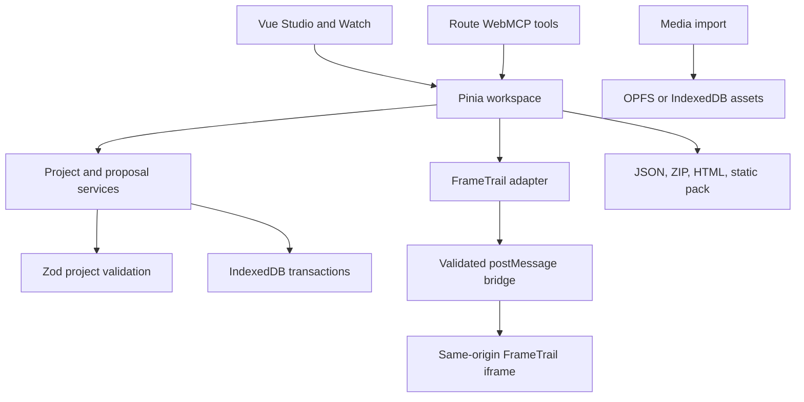

# Architecture

TimeTrail has one portable project model and one set of domain actions. Vue
components and WebMCP call those actions. Neither writes FrameTrail internals.

## Portable project

`src/domain/model.ts` defines schema version `1.0`. A project contains metadata,
sequences, media, settings, and provenance. Each sequence has clips and timed
cues. Media sources are remote HTTP URLs, generated card documents, or logical
asset IDs. Blob URLs and directory handles never enter the project snapshot.

Zod validates IDs, source protocols, reference integrity, clip overlap, cue
bounds, quiz answers, and branch destinations. The published JSON Schema captures
the structural rules. Referential and cross-field checks remain in the runtime
validator. There is no silent migration from unknown versions.

`TimelineCompiler` accepts ordered segments with duration weights and context.
It allocates milliseconds with the final segment absorbing rounding, resolves
media, creates generated cards when no media is supplied, and emits operations.
The same input and project produce the same IDs and operations. Human cues
survive storyboard replacement, with timing clamped to the new duration.

## Approved state and proposals

Project records contain the approved snapshot, monotonic revision, undo and
redo snapshots, and applied transaction IDs. A proposal has its own base revision,
operations, warnings, counts, and item decisions. Creating or previewing one
cannot update the approved record.

`ProposalService.review` reads the current record inside a read/write IndexedDB
transaction. It verifies the expected revision, combines selected operations,
validates the resulting whole project, and writes the snapshot, history, proposal
decisions, and audit event together. A failure aborts the transaction. Repeated
acceptance does not apply the same operations again. Stale proposals require a
new draft. Item acceptance respects resource dependencies; accepting a cue before
its required resource produces a validation error.

Undo and redo retain 30 snapshots and increment the revision. They do not erase
the audit history. Export and sharing always use the approved project, even while
the visible player is previewing a proposal.

## Editor drafts

`stores/editor.ts` owns the six visible authoring forms and their opening
project, sequence and revision. The media library, cue inspector, timeline and
screen/project dialogs bind to these drafts. `editorTools.ts` validates semantic
form actions and passes them to that same store. It does not query DOM selectors.

The store compiles form values into existing domain operations. Human Save
commits through `ProjectService`; tool submission creates a proposal through
`ProposalService`. Both paths validate the complete resulting project. Form
revisions prevent a delayed fill or save from overwriting a newer edit.

## Timeline gestures

`TimelineEditing.ts` computes moves, reorders and edge trims without changing the
approved project. `useTimelineDrag.ts` captures the pointer and the starting
revision. It draws a temporary sequence during the gesture, then saves one
transaction on release. Escape, pointer cancellation, focus loss or a changed
project/sequence/revision discard the preview. Undo restores the entire edit.

Clips dropped over another clip insert before or after its center. Gaps remain
between the timeline slots. A clip dropped into free space moves independently.
Fully contained cues follow each moved clip; cues spanning clip boundaries keep
their original times. Edge trims change only the selected item. Video/audio
trims adjust source in/out points and respect known source duration.

Pointer coordinates account for horizontal scrolling, and the track scrolls
near its edges during a drag. Default snapping uses tenth-second increments and
nearby item/playhead boundaries. Shift disables it. Arrow keys change timing by
0.1 seconds, Shift + arrows by one second, and Alt + arrows reorder clips.
WebMCP `timeline.propose` calls the same calculation and stages a proposal.

## Persistence

`BrowserWorkspaceStore` opens `timetrail-v1` with stores for projects,
projectRevisions, proposals, toolEvents, settings, assetMetadata, assetBlobs,
and localGalleryIndex. Local binary files go into `timetrail/assets` in OPFS.
If OPFS is unavailable or denied, binary blobs go into IndexedDB. Asset metadata
records which backend to read. Missing assets produce a recoverable message.

The last-opened project ID persists across sessions. Gallery search derives
current local entries from approved records. Static gallery providers are
read-only and have separate size, timeout, schema, and HTTP URL checks.

## Runtime ownership

The parent owns authoring, proposals, branch history, context pinning, and
accessibility controls. FrameTrail owns the playhead. A null-video FrameTrail
instance provides sequence time for generated or mixed stories. An additional
FrameTrail instance displays the active real video or audio clip. This adapts
FrameTrail's single-base-clip API to an ordered clip sequence.

The adapter resolves local asset IDs to temporary addresses. The bridge validates
message shape, origin, and source window. A changed revision or sequence replaces
the Studio iframe. Standalone viewers reinitialize and destroy prior players.
Temporary addresses are revoked when the preview is replaced or unmounted.

## Export and offline behavior

JSON is the approved project alone. ZIP adds assets, caption files, attribution,
manifest, and optional thumbnail. HTML includes the approved project, asset data,
a bundled viewer client, and an iframe runtime in `srcdoc`. A static pack stores
the same runtime as a file and assets as relative files. The viewer client has
no dependency on the Studio database or application server.

The production service worker precaches the application, FrameTrail runtime,
fonts, export bundles, schemas, and demo. It uses a content-derived cache name.
Known local files are cache-first. Other requests use the network, with the app
shell as an offline navigation fallback. Remote media is not downloaded silently.

## Security and extension points

Text uses Vue escaping, DOM text nodes, or escaped and sanitized FrameTrail
annotations. Imported code snippets and custom CSS never reach the runtime.
Tool arguments are bounded. Audit argument summaries omit source text and URLs.
External links use `noopener noreferrer`. The app does not accept arbitrary
iframe HTML, executable URLs, or raw browser code through its tools.

Add media types in `MediaImportService` and the mapper. Add future storage
providers behind `StorageProvider`. Add gallery sources behind `GalleryProvider`.
Keep provider integrations out of Vue components. Future schema versions need
an explicit migration before the current validator.
